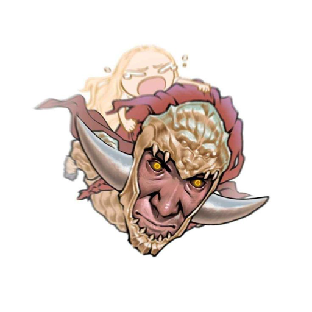

# AfterTouch

AfterTouch is a personal macOS project exploring music controls, album artwork, and synced lyrics for the MacBook notch and Lock Screen.

## What it includes

- A compact notch player with track details, artwork, playback controls, and audio activity.
- A Lock Screen music card with album art and timed lyrics.
- Separate playback providers for Spotify and Apple Music.
- Optional synced lyrics lookup through LRCLIB.
- Settings for player appearance, artwork, lyric display, and Lock Screen placement.

Lyrics lookup sends the current track title, artist, album, and duration to LRCLIB. Availability depends on the track. The active-line fill estimates timing between synced lines and does not represent word-level timestamps.

## Requirements

- macOS 14 or later
- Xcode
- A MacBook with a camera notch for the notch player
- Spotify and/or Apple Music for media controls

## Build

Open `LyricGlass.xcodeproj` in Xcode and build the `Nocta` scheme. The Xcode project is also configured with XcodeGen in `project.yml`.

## License and credits

This project is distributed under GPL-3.0-or-later. See [LICENSE](LICENSE) and [NOTICE](NOTICE) for license and third-party attribution details.
